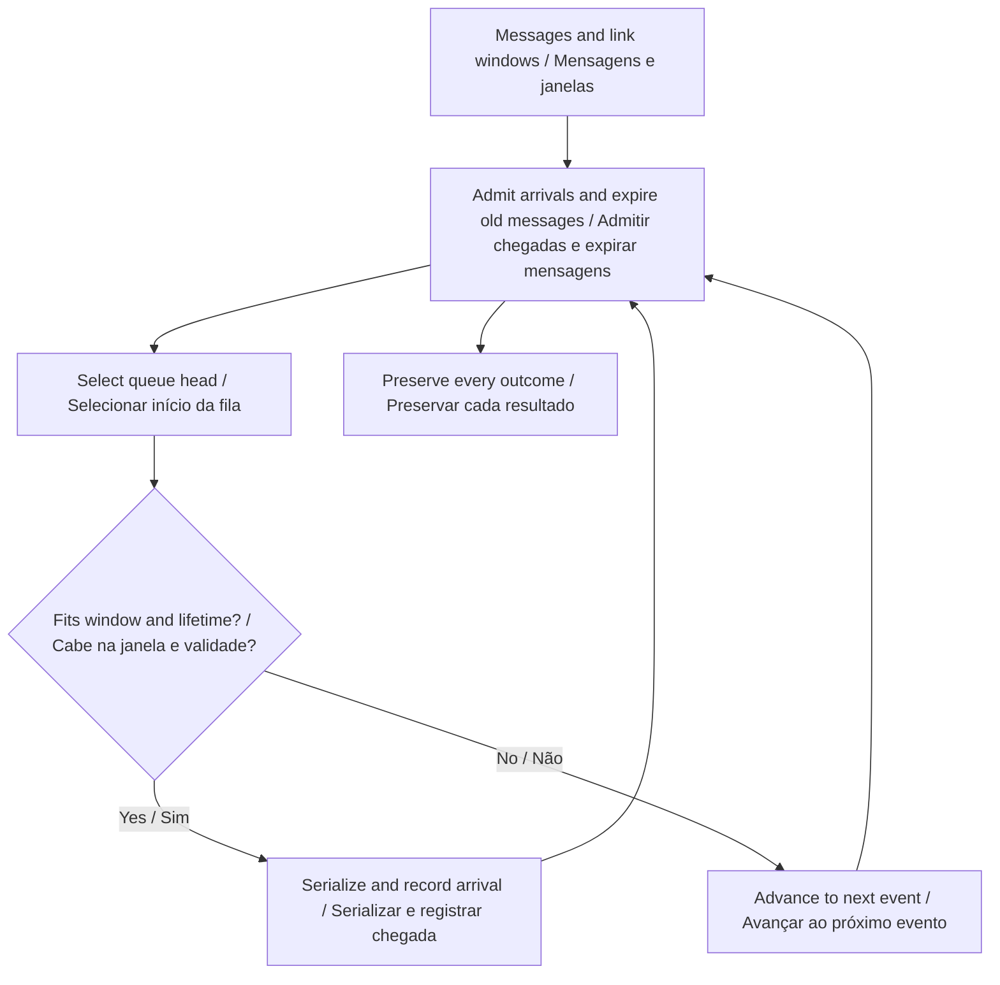
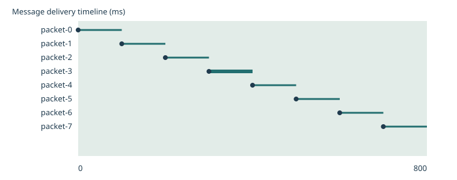
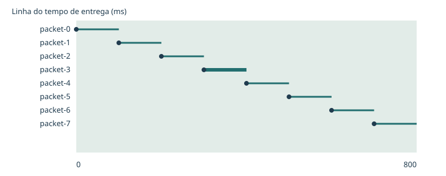

# Go2 PRO Link Resilience

**Expose delivery delays and expired messages in intermittent links.**  
**Identifique atrasos de entrega e mensagens expiradas em conexões intermitentes.**

[](https://github.com/galafis/go2-pro-link-resilience/actions/workflows/ci.yml) · **Working software prototype / Protótipo funcional** · **v0.1.0** · **27 automated tests / testes automatizados** · **MIT**

[English](#english) · [Português](#portugues) · [Live demo · Demonstração](https://galafis.github.io/go2-pro-link-resilience/) · [Five examples · Cinco exemplos](#examples)

## Workflow · Fluxo de trabalho



<a id="english"></a>

## English

A discrete-event simulator for coded message delivery over supplied availability windows. It accounts for serialization, propagation delay, priority, expiration and head-of-line blocking.

### Why this belongs in the Go2 PRO program

A search exercise can collect an observation before it can deliver it. This workbench separates those times and makes undelivered messages visible. It supports planning what to record during a prospective Go2 PRO communication-observation exercise without claiming a radio model or sending device commands.

### Implemented behavior

- Normalize non-overlapping link windows by start time. Rates use decimal kilobits per second; 1,000 bytes at 100 kbps require 80 ms of serialization.
- Queue arrived messages by descending priority, creation time and identifier. A transmission is non-preemptive and occupies exactly one transmitter.
- Require the entire serialization interval to fit one availability window. Arrival is serialization end plus the window's propagation delay; propagation does not occupy the transmitter.
- Accept arrival exactly at expiration. If the queue head cannot fit, lower-priority messages wait. Reevaluate priority at subsequent arrivals, window transitions or expirations.
- Retain one outcome per message. An undelivered message has null delivery timestamps and an explicit reason. Compute p95 delay only over delivered messages using nearest rank.



### Run a complete experiment

Use **Node.js 22 or newer**. The application has no third-party runtime dependencies and does not require an account, API key or connected robot.

```sh
git clone https://github.com/galafis/go2-pro-link-resilience.git
cd go2-pro-link-resilience
npm test
npm run examples
npm start
```

Open **http://127.0.0.1:4173**. Select one of the five examples, change **Message lifetime multiplier**, and choose **Update**. Expand the JSON editor to edit the complete scenario. Inspect the chart, review cursor, findings and full-record preview. Export the scenario and report together; only the language preference is stored automatically.

The browser demo and command line use the same `run(scenario)` domain function:

```sh
node scripts/analyze.mjs examples/nominal.json report.json
npm run test:coverage
```

Exit codes are **0** for a completed analysis or review notes, **2** for a valid report requiring review, and **1** for invalid input. Code 2 still writes the report. Imported files are limited to 1 MB; malformed data does not replace the last valid browser result.

### Reproduce a result by hand

In the nominal scenario, each 1,000-byte message arrives 100 ms after creation: 80 ms serialization plus 20 ms propagation. All eight messages are delivered. The blocking example places a 10,000-byte high-priority message before a 10-byte message on an 8 kbps link. The large message expires at 1,000 ms; only then can the small message start, arriving at 1,010 ms.

```text
serializationMs = 8 × sizeBytes / kbps
arrivalMs = transmissionStartMs + serializationMs + latencyMs
expiryMs = createdMs + ttlMs × ttlScale
```

The [worked examples](docs/EXPERIMENTS.md) list actual output metrics for all five scenarios. The [algorithm guide](docs/ARCHITECTURE.md) explains the calculation and event flow; the [data contract](docs/DATA_CONTRACT.md) specifies fields, units, limits and semantic checks.

### Validation and interpretation

Tests check known answers, boundary cases, deterministic behavior and failure handling. They also exercise the command line and bilingual chart generation. [Validation notes](docs/VALIDATION.md) link the test files and explain what they establish. Example reports are committed so a changed algorithm produces a reviewable difference.

Availability windows are supplied evidence or assumptions, not predictions of signal strength. The model omits acknowledgments, retransmission, packet corruption, transport overhead and multiple transmitters. It intentionally includes head-of-line blocking. Delivered here does not mean a real robot received or acted on anything.

### From a prototype to a controlled study

Use coded, non-personal observation messages in a controlled exercise. Record creation, transmission and reception times with a documented clock relation. Measure missing messages as well as delivered ones. Compare the supplied window model with observations before interpreting queue-policy effects.

The current release is independent of physical hardware. The [Go2 PRO development plan](docs/GO2_PRO_PLAN.md) separates software that works now from interface confirmation and physical measurements. A standard PRO configuration must not be assumed to expose custom development interfaces; confirm the exact supported configuration with Unitree.

Related work: [go2-pro-telemetry-replay](https://github.com/galafis/go2-pro-telemetry-replay). See [integration notes](docs/INTEGRATION.md) for implemented exchange and remaining boundaries.

<a id="portugues"></a>

## Português

Um simulador de eventos discretos para entrega de mensagens codificadas em janelas de disponibilidade fornecidas. Considera serialização, atraso de propagação, prioridade, expiração e bloqueio pelo primeiro da fila.

### Por que este projeto pertence ao programa com o Go2 PRO

Um exercício de busca pode coletar uma observação antes de conseguir entregá-la. A bancada separa esses instantes e torna visíveis mensagens não entregues. Apoia o planejamento dos registros de um futuro exercício de observação de comunicação com o Go2 PRO, sem afirmar um modelo de rádio ou enviar comandos ao dispositivo.

### Comportamentos implementados

- Normalize janelas de conexão sem sobreposição por início. Taxas usam quilobits decimais por segundo; 1.000 bytes a 100 kbps exigem 80 ms de serialização.
- Ordene mensagens disponíveis por prioridade decrescente, criação e identificador. A transmissão não tem preempção e ocupa exatamente um transmissor.
- Exija que toda a serialização caiba em uma janela. A chegada é o fim da serialização mais o atraso de propagação da janela; a propagação não ocupa o transmissor.
- Aceite chegada exatamente no vencimento. Se a primeira mensagem não couber, as de prioridade menor aguardam. Reavalie prioridades em chegadas, transições de janelas ou expirações.
- Preserve um resultado por mensagem. Uma mensagem não entregue tem instantes de entrega nulos e motivo explícito. Calcule atraso p95 apenas entre mensagens entregues, pela posição inteira superior.



### Executar um experimento completo

Use **Node.js 22 ou superior**. A aplicação não possui dependências externas em tempo de execução e não exige conta, chave de acesso ou robô conectado.

```sh
git clone https://github.com/galafis/go2-pro-link-resilience.git
cd go2-pro-link-resilience
npm test
npm run examples
npm start
```

Abra **http://127.0.0.1:4173**. Selecione um dos cinco exemplos, altere **Multiplicador de validade das mensagens** e escolha **Atualizar**. Expanda o editor JSON para editar o cenário completo. Inspecione gráfico, cursor de revisão, achados e prévia dos registros. Exporte cenário e relatório juntos; apenas a preferência de idioma é armazenada automaticamente.

A demonstração no navegador e a linha de comando usam a mesma função de domínio `run(scenario)`:

```sh
node scripts/analyze.mjs examples/nominal.json report.json
npm run test:coverage
```

Os códigos de saída são **0** para análise concluída ou notas de revisão, **2** para relatório válido que exige revisão e **1** para entrada inválida. O código 2 também grava o relatório. Arquivos importados são limitados a 1 MB; dados inválidos não substituem o último resultado válido no navegador.

### Reproduzir um resultado manualmente

No cenário nominal, cada mensagem de 1.000 bytes chega 100 ms após a criação: 80 ms de serialização e 20 ms de propagação. As oito mensagens são entregues. O exemplo de bloqueio coloca uma mensagem de 10.000 bytes de alta prioridade antes de uma de 10 bytes em conexão de 8 kbps. A maior expira em 1.000 ms; só então a menor inicia, chegando em 1.010 ms.

As fórmulas acima usam as unidades explicitadas no [contrato de dados](docs/DATA_CONTRACT.md). Os [experimentos comentados](docs/EXPERIMENTS.md) mostram métricas reais de saída dos cinco cenários. O [guia de arquitetura](docs/ARCHITECTURE.md) explica o cálculo e o fluxo de eventos.

### Validação e interpretação

Os testes verificam respostas conhecidas, casos de fronteira, comportamento determinístico e tratamento de falhas. Também exercitam a linha de comando e a geração dos gráficos bilíngues. As [notas de validação](docs/VALIDATION.md) apontam os arquivos de teste e explicam o que comprovam. Relatórios de exemplo são versionados para que alterações do algoritmo produzam diferenças revisáveis.

Janelas de disponibilidade são registros ou hipóteses fornecidas, não previsões de intensidade de sinal. O modelo omite confirmações, retransmissão, corrupção de pacotes, sobrecarga do transporte e múltiplos transmissores. Inclui intencionalmente bloqueio pelo primeiro da fila. Entregue aqui não significa que um robô real recebeu ou executou algo.

### Do protótipo ao estudo controlado

Use mensagens codificadas sem conteúdo pessoal em um exercício controlado. Registre criação, transmissão e recepção com relação documentada entre relógios. Meça mensagens ausentes e entregues. Compare as janelas do modelo com observações antes de interpretar efeitos da política de fila.

A versão atual funciona independentemente de hardware físico. O [plano de desenvolvimento com o Go2 PRO](docs/GO2_PRO_PLAN.md) separa software funcional de confirmação de interfaces e medições físicas. Não se deve presumir que uma configuração PRO padrão exponha interfaces de desenvolvimento personalizado; confirme a configuração compatível exata com a Unitree.

Trabalho relacionado: [go2-pro-telemetry-replay](https://github.com/galafis/go2-pro-telemetry-replay). Consulte as [notas de integração](docs/INTEGRATION.md) para trocas implementadas e limites restantes.

<a id="examples"></a>

## Reproducible examples · Exemplos reproduzíveis

| Scenario · Cenário                                      | Input · Entrada                         | Expected report · Relatório esperado                  | Status         |
| ------------------------------------------------------- | --------------------------------------- | ----------------------------------------------------- | -------------- |
| Continuous link<br>Conexão contínua                     | [nominal.json](examples/nominal.json)   | [nominal.report.json](examples/nominal.report.json)   | `complete`     |
| Intermittent link<br>Conexão intermitente               | [outage.json](examples/outage.json)     | [outage.report.json](examples/outage.report.json)     | `complete`     |
| Expired messages<br>Mensagens expiradas                 | [expiry.json](examples/expiry.json)     | [expiry.report.json](examples/expiry.report.json)     | `review-notes` |
| No link windows<br>Sem janelas de conexão               | [absent.json](examples/absent.json)     | [absent.report.json](examples/absent.report.json)     | `review-notes` |
| Head-of-line blocking<br>Bloqueio pelo primeiro da fila | [blocking.json](examples/blocking.json) | [blocking.report.json](examples/blocking.report.json) | `review-notes` |

## Repository guide · Guia do repositório

| File · Arquivo                                 | Purpose · Objetivo                                                                                   |
| ---------------------------------------------- | ---------------------------------------------------------------------------------------------------- |
| [src/engine.js](src/engine.js)                 | Domain implementation / Implementação de domínio                                                     |
| [test/](test/)                                 | Numerical, behavioral and integration checks / Verificações numéricas, de comportamento e integração |
| [docs/ARCHITECTURE.md](docs/ARCHITECTURE.md)   | Algorithms and Mermaid sequence / Algoritmos e sequência Mermaid                                     |
| [docs/DATA_CONTRACT.md](docs/DATA_CONTRACT.md) | Fields, units, validation / Campos, unidades, validação                                              |
| [docs/EXPERIMENTS.md](docs/EXPERIMENTS.md)     | Worked examples / Exemplos comentados                                                                |
| [docs/VALIDATION.md](docs/VALIDATION.md)       | Evidence and test boundaries / Evidências e limites dos testes                                       |
| [docs/GO2_PRO_PLAN.md](docs/GO2_PRO_PLAN.md)   | Platform development stages / Etapas de desenvolvimento com a plataforma                             |
| [CONTRIBUTING.md](CONTRIBUTING.md)             | Reproducible contributions / Contribuições reproduzíveis                                             |
| [SECURITY.md](SECURITY.md)                     | Local data handling / Tratamento local dos dados                                                     |

Maintainer / Responsável: **Gabriel Demetrios Lafis** · [gabrieldemetrioslafis@usp.br](mailto:gabrieldemetrioslafis@usp.br)

Independent public research prototype. No vendor or institutional endorsement is claimed. / Protótipo público independente de pesquisa. Não se afirma endosso do fabricante ou institucional.
