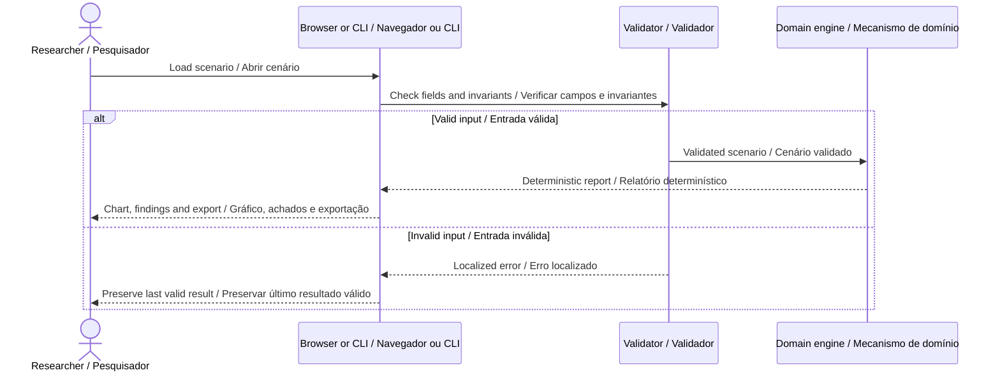

# Architecture · Arquitetura

[README](../README.md) · [Contract / Contrato](DATA_CONTRACT.md)



## English

A discrete-event simulator for coded message delivery over supplied availability windows. It accounts for serialization, propagation delay, priority, expiration and head-of-line blocking.

1. Normalize non-overlapping link windows by start time. Rates use decimal kilobits per second; 1,000 bytes at 100 kbps require 80 ms of serialization.

2. Queue arrived messages by descending priority, creation time and identifier. A transmission is non-preemptive and occupies exactly one transmitter.

3. Require the entire serialization interval to fit one availability window. Arrival is serialization end plus the window's propagation delay; propagation does not occupy the transmitter.

4. Accept arrival exactly at expiration. If the queue head cannot fit, lower-priority messages wait. Reevaluate priority at subsequent arrivals, window transitions or expirations.

5. Retain one outcome per message. An undelivered message has null delivery timestamps and an explicit reason. Compute p95 delay only over delivered messages using nearest rank.

```text
serializationMs = 8 × sizeBytes / kbps
arrivalMs = transmissionStartMs + serializationMs + latencyMs
expiryMs = createdMs + ttlMs × ttlScale
```

The engine receives plain JSON and returns plain data. It has no browser, network or private-core dependency. Validation finishes before computation. Reports preserve the source label and analysis version, omit wall-clock timestamps and can be compared byte-for-byte after formatting. The browser uses a revision counter to prevent an older import from replacing a newer result. Every displayed external string is escaped.

## Português

Um simulador de eventos discretos para entrega de mensagens codificadas em janelas de disponibilidade fornecidas. Considera serialização, atraso de propagação, prioridade, expiração e bloqueio pelo primeiro da fila.

1. Normalize janelas de conexão sem sobreposição por início. Taxas usam quilobits decimais por segundo; 1.000 bytes a 100 kbps exigem 80 ms de serialização.

2. Ordene mensagens disponíveis por prioridade decrescente, criação e identificador. A transmissão não tem preempção e ocupa exatamente um transmissor.

3. Exija que toda a serialização caiba em uma janela. A chegada é o fim da serialização mais o atraso de propagação da janela; a propagação não ocupa o transmissor.

4. Aceite chegada exatamente no vencimento. Se a primeira mensagem não couber, as de prioridade menor aguardam. Reavalie prioridades em chegadas, transições de janelas ou expirações.

5. Preserve um resultado por mensagem. Uma mensagem não entregue tem instantes de entrega nulos e motivo explícito. Calcule atraso p95 apenas entre mensagens entregues, pela posição inteira superior.

O mecanismo recebe JSON simples e retorna dados simples. Não depende do navegador, rede ou núcleo privado. A validação termina antes do cálculo. Relatórios preservam origem e versão, omitem horários reais de execução e podem ser comparados após formatação. O navegador usa um contador de revisão para impedir que uma importação antiga substitua resultado mais recente. Todo texto externo exibido passa por escape.

## Module boundaries · Limites dos módulos

| Module · Módulo       | Responsibility · Responsabilidade                                                   |
| --------------------- | ----------------------------------------------------------------------------------- |
| `engine.js`           | Validated domain calculation / Cálculo de domínio validado                          |
| `validation.js`       | Strict primitives and report envelope / Validações estritas e envelope do relatório |
| `view.js`             | Domain chart and interpretation / Gráfico e interpretação do domínio                |
| `app.js`              | Import, language, controls and export / Importação, idioma, controles e exportação  |
| `ui.js`               | Escaping, numbers and downloads / Escape, números e downloads                       |
| `scripts/analyze.mjs` | Command-line entry point / Entrada por linha de comando                             |
